<div align="center">

# 墨线 · patent-figure-kit

**给专利工程师和代理师的「STEP 一键出附图」工具**

从 3D 模型到按国家知识产权局形式要求排版的说明书附图。<br>
标号、引线、版面由程序确定性计算，可复现、可离线、可审计。

[](LICENSE)
[](#安装)
[](CHANGELOG.md)
[](SKILL.md)
[](AGENTS.md)

**[三步成图](#三步成图) · [你会得到什么](#你会得到什么) · [数据与隐私](#数据与隐私) · [为什么可信](#为什么可信) · [安装](#安装) · [性能](#性能实测) · [路线图与已知限制](#路线图与已知限制) · [English](#english)**

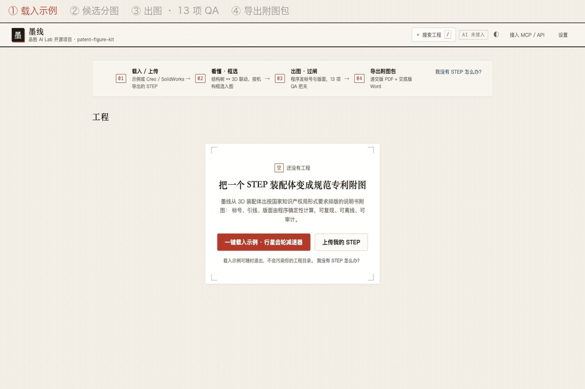

<sub>真实录屏：全新数据目录、无缓存首次运行，等待处定格、不快进，右上角计时取自录制日志（<a href="docs/assets/readme/hero-run.json">hero-run.json</a>）。单次运行，测于 Apple M5 · macOS 27.0.1 · Python 3.9.6 · 提交 7f2d653，AI 关闭。<br>示例模型由 <code>scripts/make_demo_assemblies.py</code> 生成，与任何真实产品无关。</sub>

**品胜 AI Lab 开源项目**

<sub>开发期显示名「墨线」与「品胜 AI Lab」署名均须通过首次外发门禁确认（产品名与署名确认、商标检索），确认前可能调整。</sub>

</div>

> **和生成式描边工具有什么不同？** 在我们 2026 年 10 月调研的 7 款涉及附图的商业 AI 专利产品里，做结构附图的几款从草图、照片或截图出发，用生成式模型描边再人工改标号，其余是流程图生成或传统画图工具加自动编号；未见宣称从 3D 几何做确定性消隐的。墨线走另一条路：线条从 STEP 几何算出来，标号由程序发放，AI 只做填空（读代号、起中文名、整理方法描述），碰不到坐标、字高和编号。

> [!NOTE]
> 墨线（`DISPLAY_NAME`）是开发期显示名，「品胜 AI Lab」（`BRAND`）是开发期署名，两者均须通过首次外发门禁确认；仓库技术名保留 `patent-figure-kit`；`SKILL.md` 曾用名 `patent-drawing-dwg-cleanup`。见[命名与商标声明](#命名与商标声明)。

---

## 三步成图

<table>
  <tr>
    <td align="center" width="33%">
      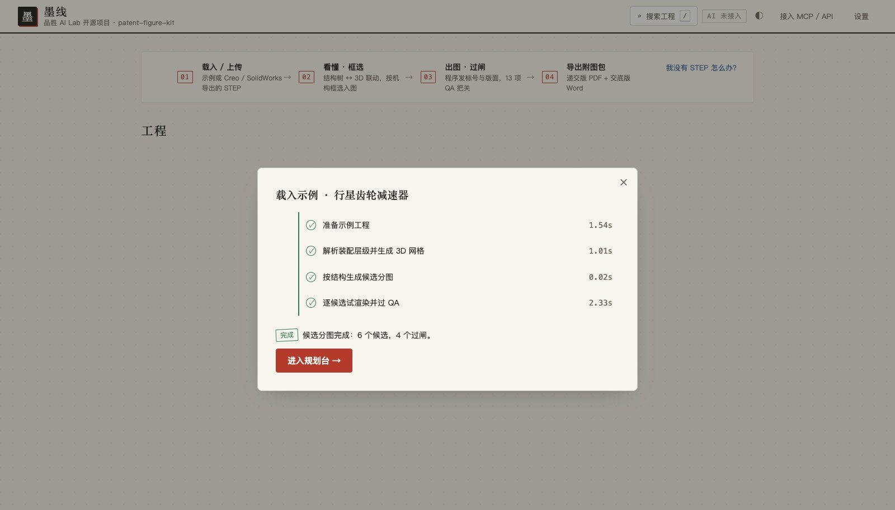<br>
      <sub><b>① 拖入 STEP</b> — 解析装配层级、生成 3D 预览，按子装配和同轴组给出候选分图；每张候选都先试渲染、过闸门，再告诉你结果。不用写配置。</sub>
    </td>
    <td align="center" width="33%">
      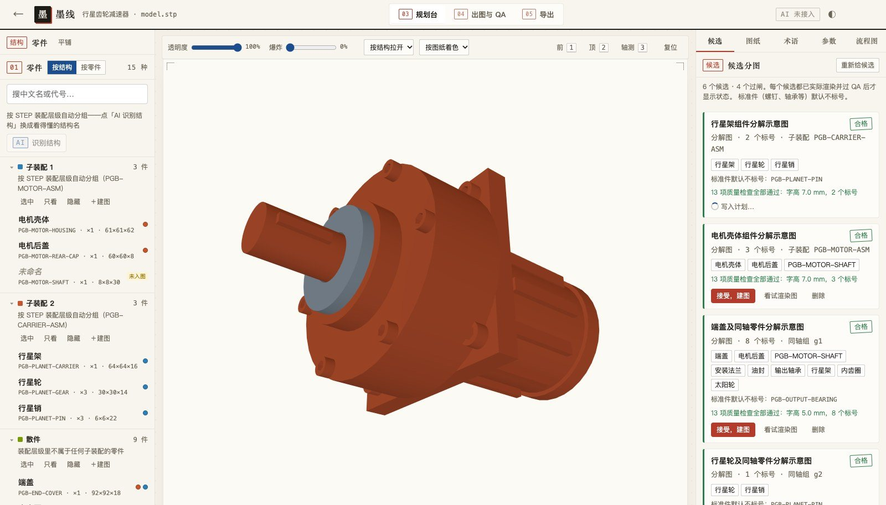<br>
      <sub><b>② 确认分图</b> — 过闸的候选盖绿章，没过的写明原因与建议。螺钉、轴承等标准件默认不标号；也可以在 3D 里框选零件自己分组。</sub>
    </td>
    <td align="center" width="33%">
      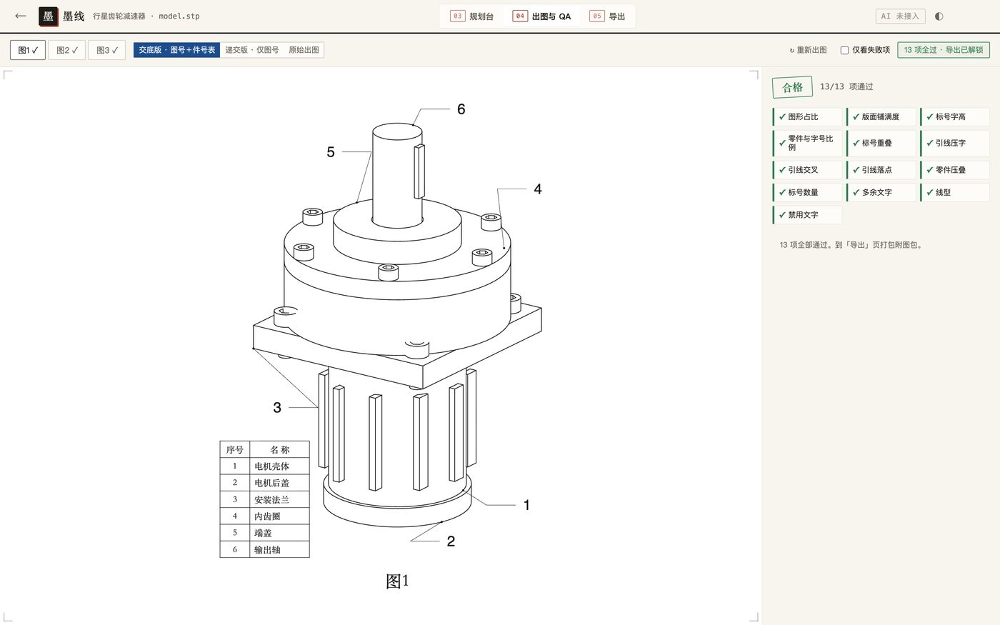<br>
      <sub><b>③ 出图并导出</b> — 解析式隐藏线消隐、引线避让、程序发号，过 13 项质量闸门；全部通过才解锁「导出附图包」。</sub>
    </td>
  </tr>
</table>

首屏动图那一次运行（单次）：示例「行星齿轮减速器」（15 种零件 / 27 个实例，见 [`models.json`](docs/assets/readme/runs/models.json)），从点下示例到拿到压缩包用了 **15.2 秒**（载入与候选分图 5.3 s、出图 2.3 s、打包与逐页核验 6.8 s；三段之和小于总时长，差额是步骤之间的点击间隔），全新数据目录、无缓存首次运行，记录见 [`hero-run.json`](docs/assets/readme/hero-run.json)。3 次样本的中位数见[性能](#性能实测)。

没有 STEP？Creo、SolidWorks、CATIA、NX、Inventor、Fusion 等主流 CAD 都能「另存为 / 导出」STEP（`.stp` / `.step`），导出时选「装配体」并保留零件名。墨线只收 STEP，不直接读原生格式。

## 你会得到什么

「导出附图包」生成一个 zip（下图都取自同一次真实导出）：

<table>
  <tr>
    <td align="center" width="33%">
      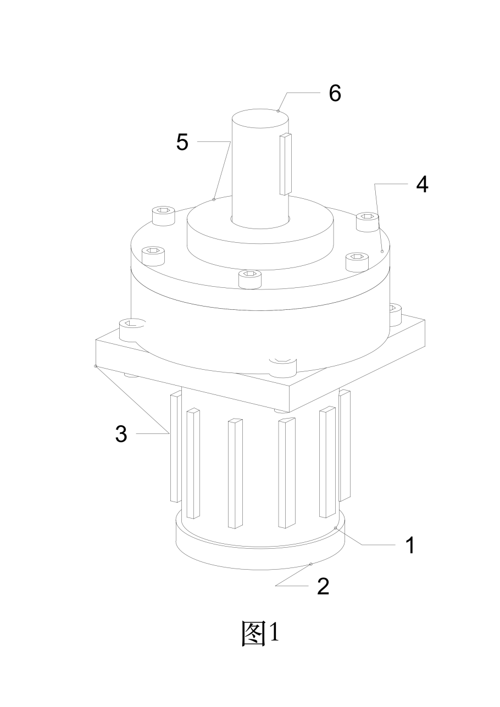<br>
      <sub><b>递交版 PDF</b>（主交付）— 仅图号；A4，按形式要求留页边，图号在图正下方。<code>pypdfium2</code> 栅格。</sub>
    </td>
    <td align="center" width="33%">
      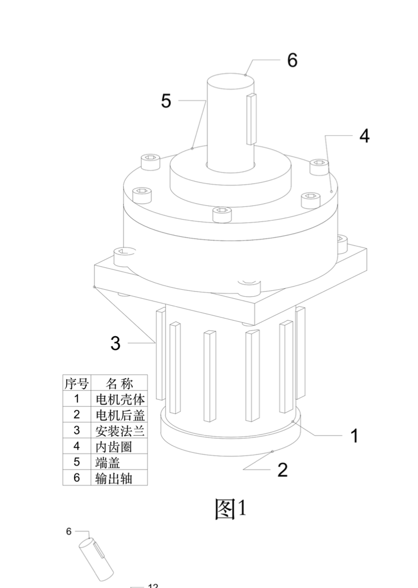<br>
      <sub><b>交底版 Word</b>（主交付）— 多一张件号名称表，供研发与代理师核对。图为 macOS Quick Look 文档预览，<b>非实际分页验证</b>（底部已露出下一张图）；Word 只做结构核验，实际排版以 Word 打开为准。</sub>
    </td>
    <td align="center" width="33%">
      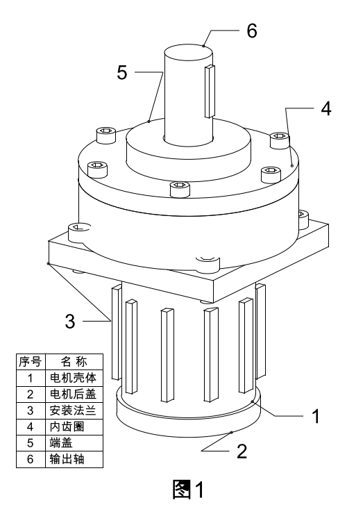<br>
      <sub><b>DXF 源文件</b>（供再编辑；装了 AutoCAD 或 LibreDWG 还可出 DWG）。ezdxf 渲染，本机未装长仿宋字体，中文按回退字体显示。</sub>
    </td>
  </tr>
</table>

包里另有两份文本，`附图说明.txt` 可以直接粘进说明书：

```text
【附图说明】
图1为行星齿轮减速器整体结构示意图；
图2为行星齿轮减速器齿轮系分解示意图；
图3为行星架组件分解示意图。

附图标记说明：1—电机壳体；2—电机后盖；3—安装法兰；4—内齿圈；5—端盖；6—输出轴；7—太阳轮；8—行星轮；10—行星架；11—输出轴承；12—油封。
```

`核对清单.txt` 记录机器逐页核验的结果，并列出必须人工核对的项（节选）：

```text
一、机器逐页核验（文件本身，不是源图）
  [通过] 说明书附图_交底版.pdf：3/3 页
  [通过] 说明书附图_递交版.docx：3/3 页
二、必须人工核对（本工具 M1 不做说明书自动对表）
  [ ] 说明书「附图标记说明」与每张图上的标号逐条一致（见 reference-numerals.json）
  [ ] 递交用的是「递交版」（仅图号）；「交底版」带件号表，只用于内部交底
```

完整清单：`说明书附图_递交版.pdf / .docx`、`说明书附图_交底版.pdf / .docx`、`递交版_仅图号/*.dxf`、`交底版_带件号表/*.dxf`、`附图说明.txt`、`核对清单.txt`、`核验报告.json`（每个文件的 sha256 与逐页核验明细）、`reference-numerals.json`。

> [!IMPORTANT]
> 版式按 CNIPA 形式要求排版（A4，页边上 25 / 左 25 / 下 15 / 右 15 mm，图区默认 170×257 mm，可选保守版心 165×245 mm，默认 300 dpi），**最终以受理为准，不构成法律意见**。精确图片参数以当期《电子申请文件格式要求说明》为准。条款出处见 [`references/patent-figure-spec.md`](references/patent-figure-spec.md)。

## 数据与隐私

公开前的专利附图是商业秘密，所以这一段放在前面。

- **本地出图，模型不出机。** 解析、消隐、标号、闸门、导出全部在你的电脑（或你自己的服务器）上完成，核心出图链路不依赖任何外部接口。工作台默认只监听 `127.0.0.1`。
- **AI 是可选项。** AI 只用于起草零件中文名、识别结构分组、整理流程图文字，碰不到坐标、字高和编号。通道关闭时不发出任何 AI 请求，流程照样走完（零件名在术语页自己填）。
  - **默认是「自动」**：检测到环境变量 `DEEPSEEK_API_KEY`，或本机装有 CodeBuddy CLI，就会启用通道，不需要你另外配置。
  - **AI 起名：逐次确认。** 外发前界面列明发给谁、发哪些字段（只含你选中的空白件）。
  - **AI 识别结构：不逐次确认。** 通道可用时，上传 STEP 或载入示例后，工作台会在后台**自动**调用该通道识别一次（上传对话框会提示）。
    - **会发送（由几何派生的元数据）**：每个零件的零件名 / 代号、实例数、包围盒尺寸、零件中心坐标、装配路径；整机包围盒与主轴方向；已经填过的人工名称。工程里有术语库或 BOM 映射时，二者整体附入。计划 `source.exclude` 的排除（以及退化件）只作用于逐件元数据列表；若配置了术语库或 BOM，整份映射（可能含被排除零件的代号与名称）仍会随结构识别请求发送——`source.exclude` 不构成外发隔离；保密模型导入前请关闭 AI 通道。
    - **不发送**：STEP 文件本身，以及任何几何数据（实体、曲面、网格）。注意：坐标、尺寸、装配路径虽不是几何文件，仍能反映零件的位置关系和装配结构。
  - **怎样关闭（请在导入未公开的模型之前设好）**：启动前设环境变量 `PFK_AI_PROVIDER=none`（例：`PFK_AI_PROVIDER=none python3 scripts/pfk_cli.py start`），或在 `~/.config/patent-workbench/config.json` 里写 `"provider": "none"`。首页右上角显示「AI 未接入」即为已关闭。当前版本的「设置」对话框里还没有「不使用 AI」选项，只能用这两种方式关闭。
- **演示站无需上传。** 静态演示站只放三个公开示例的预计算结果，不能上传，也不出图。
- **数据放在哪。** 工程数据在 `~/.patent-workbench`，设置与密钥在 `~/.config/patent-workbench/config.json`（权限 0600），都不在仓库里。密钥只经环境变量或本机配置文件提供，不会写进仓库；请不要提交这两个目录。

## 为什么可信

| 承诺 | 怎么被检查 | 本轮结果 |
| --- | --- | --- |
| **同一计划，摘要一致** | 验收 N10：把本机渲染的规范化图元摘要与仓库金样（`tests/fixtures/golden_digest.txt`）比对；N10b 扩展到线色、线宽、线型、TEXT 旋转与对齐 | 通过（`fig1=4071955194ac…`、`fig2=669a2dc51098…`） |
| **闸门不是摆设** | N8：把合格图的引线锚点故意搬离 40 mm，闸门必须判不通过 | 通过（退出码 1） |
| **没过闸的图不进交付目录** | N16：故意制造失败件，断言输出目录里没有它，且保留上一完整版本 | 通过 |
| **常驻进程与命令行出同一张图** | N15：CLI、常驻 worker、子进程三条路径摘要一致，A→B→A、失败→成功序列稳定 | 通过 |
| **导出包逐页核验** | N17：三个公开模型 × 两版 × PDF/Word 共 24 页；dpi 72 必须判不通过 | 通过 |
| **候选分图真能过闸** | N18：三个公开模型各至少一张候选过闸；台虎钳整机候选被拦并给建议 | 通过 |

**确定性口径**：在已验证环境（见下表）下，同一份 plan 渲染出的图纸规范化图元摘要一致——坐标取 6 位小数，覆盖几何与文字实体，不含文件头与句柄。不在表里的环境不作承诺。

本轮在提交 `d54f8aa`（出图代码与 7f2d653 相同）上整套运行 `python3 acceptance/run_acceptance.py`：**19 个节点全部通过，退出码 0**（N14 内含 685 个单元测试）。原始记录（机型、Python、提交号、逐行时间戳）：[`acceptance.jsonl`](docs/assets/readme/runs/acceptance.jsonl)。节点说明见 [`acceptance/README.md`](acceptance/README.md)。

**已验证环境**（摘自 [`docs/deploy/verified-environments.md`](docs/deploy/verified-environments.md)，只列实测通过的组合）：

| 环境 | 平台 | 架构 | Python | cadquery-ocp | 验收 | N10 | 提交 | 日期 |
| --- | --- | --- | --- | --- | --- | --- | --- | --- |
| macOS 本机（wheel，仓库外全新环境） | macOS 27.0.1 | arm64 | 3.12.15 | 7.7.2 | 19/19 | 通过 | `57311bf` | 2026-10-12 |
| macOS 本机（源码检出） | macOS 27.0.1 | arm64 | 3.9.6 | 7.7.2 | 19/19 | 通过 | `57311bf` | 2026-10-12 |

Linux、Windows 与容器的组合由 CI 矩阵（`golden-matrix.yml`）裁定，首次外发后运行，通过后才会进表。

## 安装

<!-- For AI agents: full non-interactive install + smoke test from a source checkout. No credentials, no AI channel, nothing leaves the machine.
git clone https://github.com/janauto/patent-figure-kit.git && cd patent-figure-kit
python3 -m venv .venv && . .venv/bin/activate
python3 -m pip install -U pip && python3 -m pip install -r requirements-pinned.txt -r requirements-web.txt
python3 scripts/pfk_cli.py doctor                       # expect last line: 结论：可以启动工作台。 (exit 0)
mkdir -p "$HOME/pfk-demo" && python3 scripts/make_demo_assemblies.py -o "$HOME/pfk-demo"
cp examples/planetary-gearbox/figure-plan.json "$HOME/pfk-demo/"
python3 scripts/analyze_assembly.py "$HOME/pfk-demo/demo-planetary-gearbox.stp" -o "$HOME/pfk-demo/assembly.json" --include 'PGB-*'
python3 scripts/export_figure_package.py "$HOME/pfk-demo/figure-plan.json" --assembly "$HOME/pfk-demo/assembly.json" -o "$HOME/pfk-demo/附图包"
Expected: six "[通过]" lines and "（全部通过）", exit 0; $HOME/pfk-demo/附图包 contains 说明书附图_递交版.pdf.
Python must be 3.9–3.12 (3.13+ unsupported). Full acceptance (takes several minutes): python3 acceptance/run_acceptance.py — do not pipe it, the exit code matters. -->

按你想走多深选一级：

| 级 | 适合谁 | 入口 | 状态 |
| --- | --- | --- | --- |
| 先看看 | 评估者 | 静态演示站，免注册、无需上传 | 随首次外发上线；现在可本地构建 |
| 本地 · 双击 | 代理师、企业 IPR | macOS / Windows / Linux 安装脚本 | macOS 实测；Windows、Linux 待 CI |
| 本地 · 一行命令 | 开发者 | 源码检出 + venv | macOS 实测 |
| 服务器 | 团队共用 | `docker compose up -d`（linux/amd64） | 由 CI 验证，首次外发后生效 |
| Agent | Claude Code、Codex 等 | CLI、REST、MCP、`SKILL.md` | 可用 |

**环境要求**

| 依赖 | 是否必需 | 说明 | 检查 |
| --- | :---: | --- | --- |
| Python 3.9–3.12 | ✅ | 推荐 3.12；3.13 及以上暂不支持（几何内核 cadquery-ocp 7.7.2 没有对应版本） | `python3 --version` |
| `requirements-pinned.txt` | ✅ | 出图链路：cadquery-ocp、ezdxf、numpy、jsonschema、matplotlib、pytest，版本锁定 | `python3 scripts/doctor.py` |
| `requirements-web.txt` | ✅（工作台与导出） | fastapi、uvicorn、httpx、python-multipart、openpyxl、python-docx、pypdf、**pypdfium2**。缺 pypdfium2 时 PDF 照样生成，但判「未核验」，导出不算成功 | `python3 scripts/pfk_cli.py doctor` |
| AutoCAD 或 LibreDWG | 可选 | 转 DWG；都没有时只出 DXF，界面事前禁选 DWG | 同上 |
| 长仿宋字体 `simfang.ttf` | 可选 | 只影响本机预览显示；DXF 里记录的是字体名，文件本身不受影响 | 同上 |

平台：macOS 11+（arm64 / x86_64）、Linux x86_64（glibc ≥ 2.35，如 Ubuntu 22.04+、Debian 12+）、Windows 10/11 x64。不支持 Linux ARM64、Alpine。

### 先看看：静态演示站

演示站把三个公开示例（减速器、台虎钳、球阀）的真实出图结果预先算好：可以旋转 3D、翻候选分图与闸门判词、看三版预览与 13 项 QA、下载导出包样例；不能上传，也不出图。站点随首次外发发布到 GitHub Pages；现在可以在本地构建并预览：

```bash
python3 scripts/build_static_site.py            # → static-site/patent-figure-kit/
cd static-site && python3 -m http.server 8808   # 浏览器打开 http://127.0.0.1:8808/patent-figure-kit/
```

细节见 [`docs/deploy/static-demo.md`](docs/deploy/static-demo.md)。

### 本地 · 双击安装（推荐）

先装 [Python 3.12](https://www.python.org/downloads/)（Windows 安装时勾选「Add python.exe to PATH」），再拿到本仓库（`git clone` 或下载 zip 解压）：

| 系统 | 操作 |
| --- | --- |
| macOS | 双击 `安装并启动.command`。第一次若提示「无法打开，因为来自身份不明的开发者」：右键 → 打开 → 再点「打开」。 |
| Windows | 右键 `安装并启动.ps1` →「使用 PowerShell 运行」。被拦时先在 PowerShell 里执行 `Unblock-File -Path .\安装并启动.ps1`。 |
| Linux | 终端里 `./install.sh` |

脚本会检测 Python、在用户目录建独立虚拟环境、装锁定依赖、自检，然后启动工作台并打开浏览器。**装一次几分钟，之后日常使用不碰命令行**；再次运行时依赖没变就跳过安装，几秒打开。

- 预期输出：自检结尾是 `结论：可以启动工作台。`，随后打印 `专利附图工作台已启动：http://127.0.0.1:8790/?token=…` 并打开浏览器。
- 本机实测（单次运行，2026-10-14，Apple M5 · 10 核 · 16 GB · macOS 27.0.1，脚本选用 Python 3.12.15，`PIP_NO_CACHE_DIR=1` 无 pip 缓存，运行时机器另有负载）：依赖安装 196 秒，脚本全程 272 秒。原始记录（命令、环境、逐行时间戳）：[`install-command.jsonl`](docs/assets/readme/runs/install-command.jsonl)。安装时长强依赖网络，历次记录见 [`install-times.md`](docs/deploy/install-times.md)。
- 常用参数：`--no-start`（只安装与自检）、`--port 8791`、`--data 目录`、`--reinstall`；国内网络可先设 `PIP_INDEX_URL`（如清华镜像）。
- 虚拟环境位置：macOS `~/Library/Application Support/patent-figure-kit/`，Linux `~/.local/share/patent-figure-kit/`，Windows `%LOCALAPPDATA%\patent-figure-kit\`；环境变量 `PFK_HOME` 可改。

详见 [`docs/deploy/local.md`](docs/deploy/local.md)。

### 本地 · 一行命令（源码检出）

```bash
git clone https://github.com/janauto/patent-figure-kit.git
cd patent-figure-kit
python3 -m venv .venv
source .venv/bin/activate                  # Windows：.venv\Scripts\activate
python3 -m pip install -U pip
python3 -m pip install -r requirements-pinned.txt -r requirements-web.txt
python3 scripts/pfk_cli.py doctor
```

首次安装要下载约 166 MB 的几何内核 `cadquery-ocp`（macOS arm64 · Python 3.12 的轮子，见上面的安装记录），请耐心等待。`doctor` 首次运行要导入几何内核并逐项自检，会多等一会儿；预期输出结尾是 `结论：可以启动工作台。`，退出码 `0`。

**冒烟测试：不开界面，出一套附图包**：

```bash
mkdir -p "$HOME/pfk-demo"
python3 scripts/make_demo_assemblies.py -o "$HOME/pfk-demo"
cp examples/planetary-gearbox/figure-plan.json "$HOME/pfk-demo/"
python3 scripts/analyze_assembly.py "$HOME/pfk-demo/demo-planetary-gearbox.stp" -o "$HOME/pfk-demo/assembly.json" --include 'PGB-*'
python3 scripts/export_figure_package.py "$HOME/pfk-demo/figure-plan.json" --assembly "$HOME/pfk-demo/assembly.json" -o "$HOME/pfk-demo/附图包"
```

预期输出：6 行 `[通过]`（交底版 / 递交版 × PDF、Word、DXF），最后一行之前是 `导出包：…/附图包（全部通过）`，退出码 `0`；`$HOME/pfk-demo/附图包/` 里有 `说明书附图_递交版.pdf`。`make_demo_assemblies.py` 会打印 OpenCASCADE 的 STEP 转换统计，属正常输出；导出时旁边会多一个中间目录 `附图包.work/`。

**启动工作台**：

```bash
python3 scripts/pfk_cli.py start           # 打开 http://127.0.0.1:8790/?token=…；加 --no-browser 则只打印地址
```

工程数据默认放在 `~/.patent-workbench`（与双击安装共用）；想另放一处，加 `--data 目录`。

**跑完整验收**（需要几分钟；不要用管道接输出，否则会吞掉退出码）：

```bash
python3 acceptance/run_acceptance.py       # 预期：通过 19 ／ 未通过 0 ／ 跳过 0，退出码 0
```

### wheel

PyPI 暂不发布；wheel 随 GitHub Release 提供（首次外发后）。拿到 `patent_figure_kit-0.1.0-py3-none-any.whl` 后：

```bash
python3.12 -m venv ~/.pfk-venv
~/.pfk-venv/bin/python -m pip install -U pip
~/.pfk-venv/bin/python -m pip install "patent_figure_kit-0.1.0-py3-none-any.whl[web]"
~/.pfk-venv/bin/pfk doctor --profile web
~/.pfk-venv/bin/patent-figure-kit          # 启动工作台
```

实测：仓库外全新 Python 3.12 环境里装 wheel 后跑 `pfk acceptance`，19/19 通过（见上方已验证环境表第一行，2026-10-12）。

### 服务器（Docker，linux/amd64）

```bash
cp .env.example .env      # 填 PFK_TENANT、WORKBENCH_TOKEN、PFK_PUBLIC_URL、PFK_SITE_ADDRESS、PFK_BASIC_*
docker compose up -d
```

一租户一容器：应用容器以非 root 运行、只在内部网段，前面是 Caddy（HTTPS 与访问口令；Agent 用 Bearer）。**只支持 linux/amd64。** 容器构建、镜像内验收与经代理的端到端冒烟由 CI 验证，首次外发后生效；维护者本机没有 Docker，未在本机运行过。详见 [`docs/deploy/server.md`](docs/deploy/server.md)。

### 接入 AI Agent

- **Claude Code**：把本仓库放进 `~/.claude/skills/patent-figure-kit/`，入口是 [`SKILL.md`](SKILL.md)。
- **Codex 及其他 Agent 运行时**：入口是 [`AGENTS.md`](AGENTS.md)，它只做路由，不含流程。
- **REST**：工作台的 `/v1/*`，交互文档在 `http://127.0.0.1:8790/docs`，契约在 [`docs/openapi.yaml`](docs/openapi.yaml)。
- **MCP**：`POST /mcp`（Bearer token）；首页右上角「接入 MCP / API」给出可复制的配置。
- **命令行**：`python3 scripts/pfk_cli.py <工具>`（装了 wheel 就是 `pfk <工具>`），工具有 analyze、render、annotate、qa、validate、glb、export、check、flowchart、suggest、demo-models、bench、studio。每个工具都支持 `--help`；退出码 `0` 通过、`1` 失败、`2` 用法错误。
- **规矩**：模型只写 `figure-plan.json`，不写坐标、字高、标号或绘图脚本；不驱动浏览器界面，走 REST 或 MCP。是否守规矩按 [`acceptance/行为验收.md`](acceptance/行为验收.md) 人工检查。

### 常见问题

| 现象 | 处理 |
| --- | --- |
| `pip` 装 `cadquery-ocp` 失败或找不到版本 | 确认 Python 是 3.9–3.12、Linux 是 x86_64 且 glibc ≥ 2.35；先 `python3 -m pip install -U pip` |
| 导出时 PDF 显示「未核验」 | 缺 `pypdfium2`：`python3 -m pip install -r requirements-web.txt` |
| 浏览器打开显示「需要 token」 | 从终端打印的完整地址（带 `?token=`）进入一次，之后用会话 Cookie |
| DWG 格式是灰的 | 没检测到 AutoCAD 或 LibreDWG；DXF 照常导出 |
| 端口 8790 被占用 | 安装脚本会自动换端口；命令行用 `--port 8791` |

## 功能总览

<table>
  <tr>
    <td align="center" width="50%">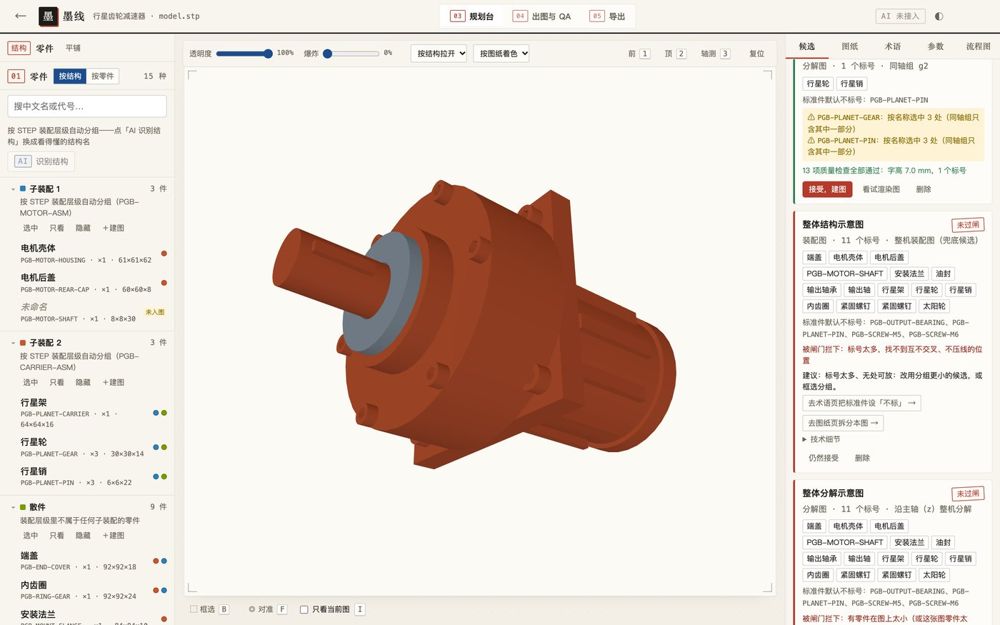<br>
      <sub><b>候选分图</b> — 子装配、同轴组、沿主轴分解、整机兜底；每张都实际渲染过闸，被拦的写明原因与建议。</sub></td>
    <td align="center" width="50%">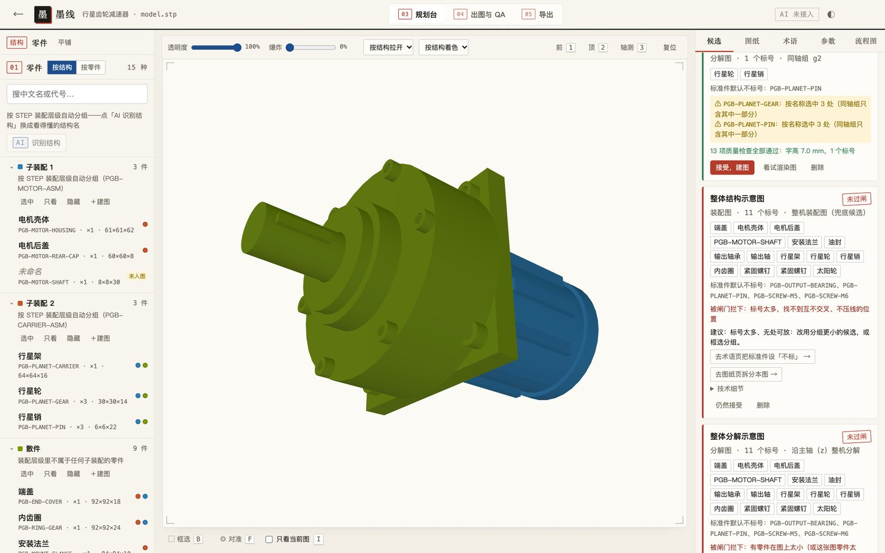<br>
      <sub><b>结构识别</b> — 按 STEP 装配层级自动分组；AI 通道可用时，导入后会<b>自动</b>外发零件名、尺寸、中心坐标、装配路径等元数据，让 AI 归成看得懂的结构组（不逐次确认；外发字段与关闭方式见<a href="#数据与隐私">数据与隐私</a>）。</sub></td>
  </tr>
  <tr>
    <td align="center">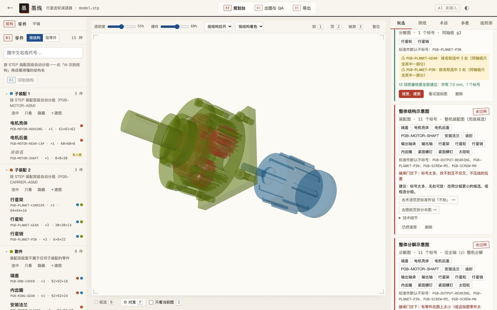<br>
      <sub><b>透明 · 爆炸</b> — 透明看内部，按结构组拉开或沿主轴分解；只影响观察，不影响出图。</sub></td>
    <td align="center">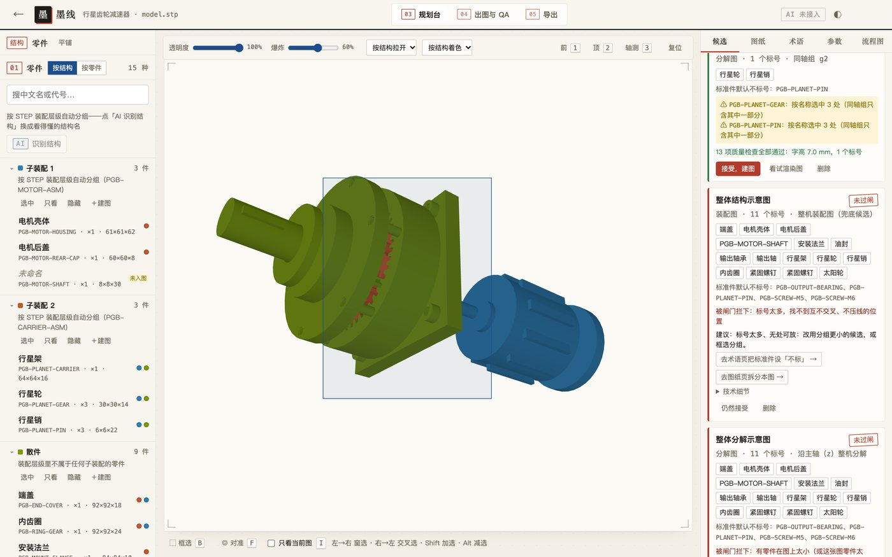<br>
      <sub><b>框选分图</b> — 按 B，左→右窗选、右→左交叉选，Shift 加选、Alt 减选；选好在图纸页新建一张图。</sub></td>
  </tr>
  <tr>
    <td align="center">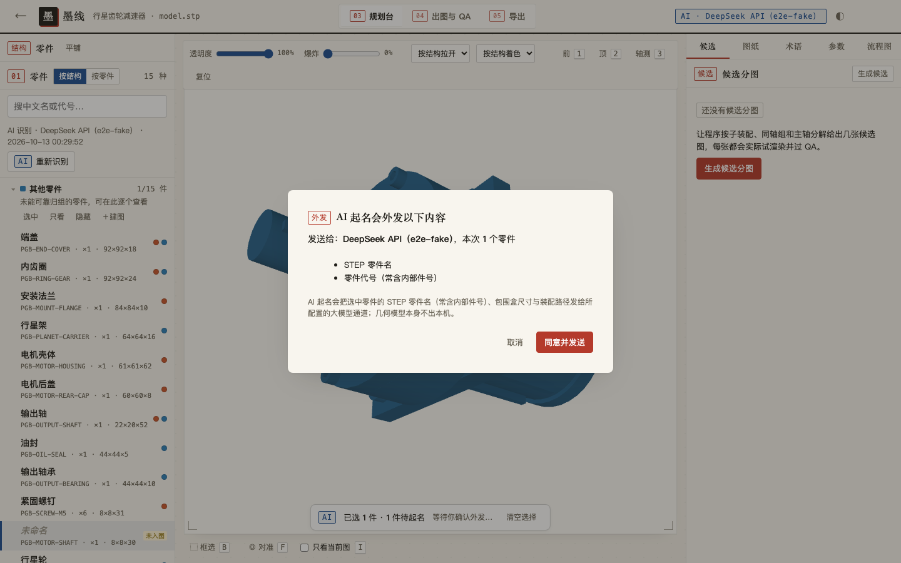<br>
      <sub><b>AI 起名接力</b> — 只给空白件起草，人工填过的不覆盖；外发前逐次确认。<i>截图为演示态：本机模拟通道，非真实 AI 结果。</i></sub></td>
    <td align="center">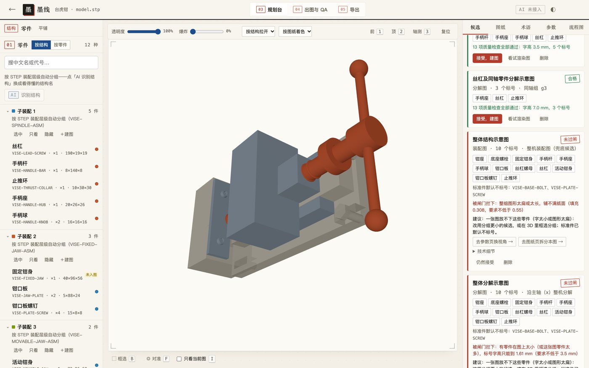<br>
      <sub><b>QA 闸门与修复引导</b> — 13 项检查各有白话原因、建议动作和直达入口；台虎钳整机图因铺不满纸面被拦。</sub></td>
  </tr>
  <tr>
    <td align="center">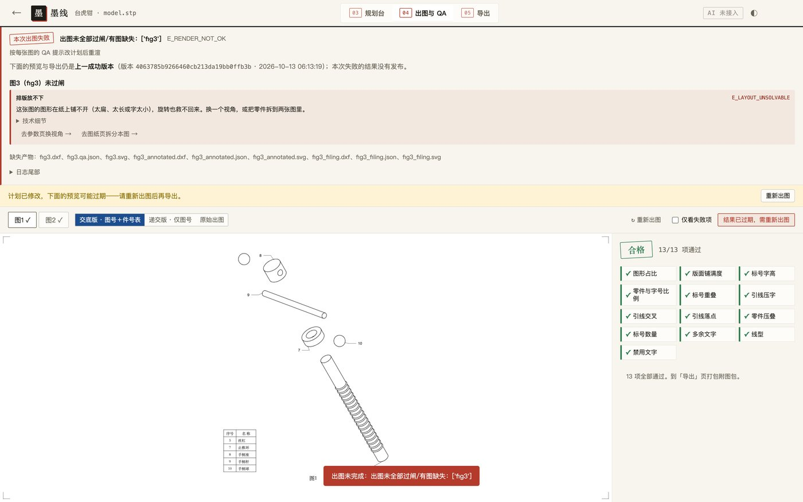<br>
      <sub><b>失败不污染交付</b> — 硬要接受被拦的图，出图会失败；预览与导出仍是上一成功版本。</sub></td>
    <td align="center">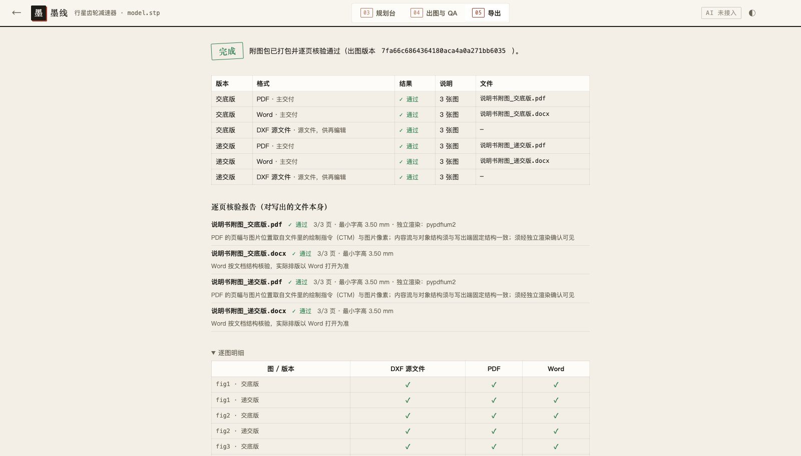<br>
      <sub><b>附图导出包</b> — 递交版 / 交底版，PDF 与 Word 为主交付，打包前对文件本身逐页核验，缺项不报成功。</sub></td>
  </tr>
  <tr>
    <td align="center">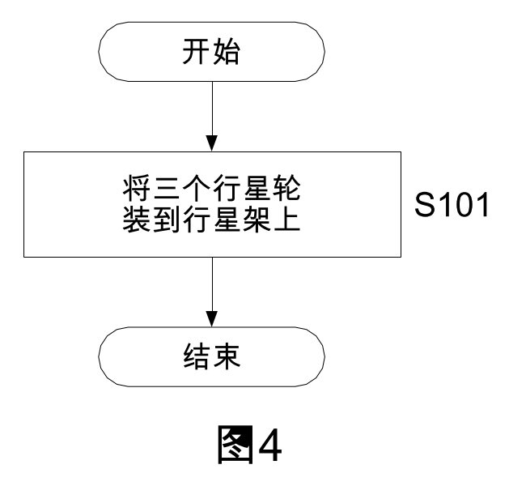<br>
      <sub><b>方法流程图</b> — 填好步骤与走向（或让 AI 从一段文字起草），S101 式步骤号由程序发放，图号接在结构附图之后。</sub></td>
    <td align="center">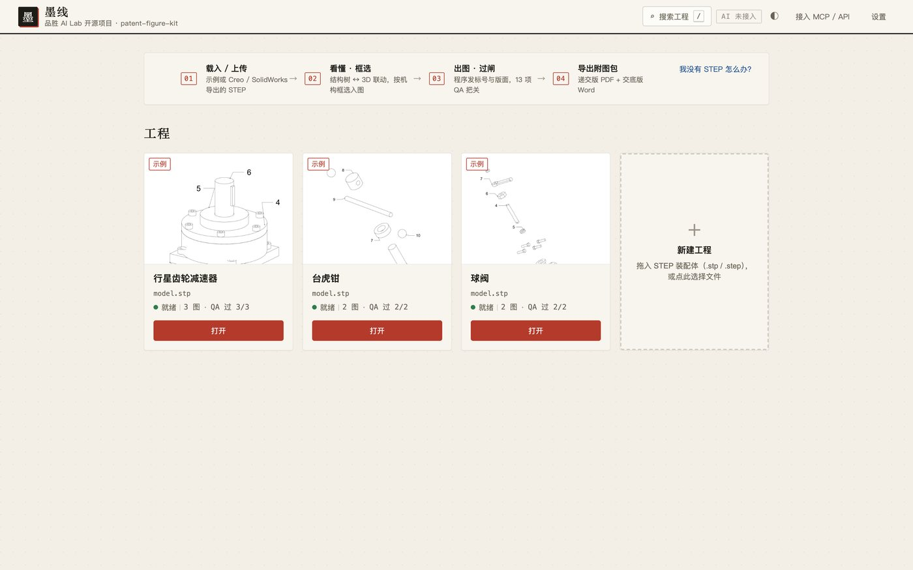<br>
      <sub><b>工程列表</b> — 三个公开示例一键载入；新建工程拖入 STEP 即可。</sub></td>
  </tr>
</table>

**快捷键**：`B` 框选 · `F` 对准 · `I` 只看当前图 · `1` / `2` / `3` 前 / 顶 / 轴测机位 · `Esc` 清空选择 · `/` 搜索工程。

**其他能力**：BOM（Excel）导入件号到中文名的映射；既有图纸清理（Route B：对已有 DXF / DWG / 矢量图去除附图标记、保留功能性文字、统一实线，并转成经审计的 DWG），见 [`SKILL.md`](SKILL.md)。

## 性能（实测）

下表附原始记录（命令、机型、版本、缓存状态、每次样本），索引见 [`docs/assets/readme/runs/`](docs/assets/readme/runs/README.md)。

**三个公开示例 · 金路径分段**（真实工作台，REST 接口与界面同一组）。每次测量都用全新数据目录和刚启动的工作台进程（几何缓存为空），AI 关闭；每项 3 次样本取中位，单位秒，计时为服务端作业起止时间。测于 Apple M5 · 10 核 · 16 GB · macOS 27.0.1 · Python 3.9.6 · cadquery-ocp 7.7.2 · 提交 7f2d653（工作树无改动）。原始记录：[`perf-golden.json`](docs/assets/readme/runs/perf-golden.json)；零件数见 [`models.json`](docs/assets/readme/runs/models.json)。

| 示例 | 规模 | 载入示例（首次） | 候选分图（含逐个试渲染） | 首次出图 | 重出图 | 改计划后出图 | 导出附图包 |
| --- | --- | ---: | ---: | ---: | ---: | ---: | ---: |
| 行星齿轮减速器 | 15 种 / 27 实例，2 张图 | 2.02 | 2.29（6 个，4 个过闸） | 1.01 | 0.94 | 1.01 | 4.78 |
| 台虎钳 | 12 种 / 20 实例，2 张图 | 2.01 | 1.07（6 个，4 个过闸） | 0.36 | 0.35 | 0.36 | 3.63 |
| 球阀 | 9 种 / 18 实例，2 张图 | 2.02 | 0.88（4 个，3 个过闸） | 0.48 | 0.49 | 0.49 | 3.81 |

- 「首次出图」排在候选分图之后，候选试渲染已让部分零件的消隐结果进了缓存；跳过候选、几何缓存完全为空时，首次出图为 1.19 / 0.55 / 0.63 秒（同条件 3 次中位，[`perf-golden-cold.json`](docs/assets/readme/runs/perf-golden-cold.json)）。
- 「导出附图包」= 递交版 + 交底版，PDF + Word + DXF，300 dpi，标准版心，含对文件本身的逐页核验。
- 「改计划后出图」= 改一个零件中文名后重出（消隐缓存命中，版面与标号重算）。
- 复测：`python3 docs/assets/measure_readme.py --reps 3 --out <文件>`（冷渲染加 `--no-suggest`）。

**大装配体性能基准：待 M2。** 现有 `scripts/bench.py --scaled` 生成的 50 / 200 实例样例是「一张图标全部零件」，单图标记数超过上限 20，在计划校验阶段（`E_TOO_MANY_LABELS`）就退出，没有走到消隐、排版和发布，所以不能代表大装配体的出图、缓存或常驻 worker 性能，这一版不发布这类数字。M2 会改用拆成多图（每图不超过 20 个标记）、能完整出图的样例重测。

## 与常见做法对比

| 做法 | 线条从哪来 | 标号与版面从哪来 | 结果可复现 | 有质量闸门 | 数据留在本地 |
| --- | --- | --- | :---: | :---: | :---: |
| 在 CAD 里手工画图、手工标号 | 人工清线 | 人工逐个摆放 | ❌ | ❌ | ✅ |
| 外包绘图 | 绘图员 | 绘图员 | ❌ | 人工复核 | ❌ 需交出模型 |
| 生成式描边工具 | 模型对草图 / 截图描边 | 模型建议 + 人工改 | ❌ | 事后检查 | 多为云端 |
| **墨线** | 从 STEP 几何解析消隐 | 程序计算，模型只填中文术语 | ✅（已验证环境） | ✅ 13 项，不过不交付 | ✅ |

## 路线图与已知限制

**M2（v1.1）计划做、这一版没做的**——写在这里，是因为我们不把没做的事说成做了：

| 项 | 现在怎么办 | 为什么现在不做 |
| --- | --- | --- |
| 剖视图 / 局部放大 | 需要时另行绘制 | 需要剖切面与剖面线规则的独立研究，先保证常规视图的确定性 |
| 大装配体性能基准 | 只发布三个公开示例的金路径实测 | 现有缩放样例在计划校验阶段就退出，不代表出图性能；要换成拆成多图、能完整出图的样例再测 |
| 说明书对表（件号 ↔ 说明书双向核对） | 导出包附《核对清单.txt》，人工核对 | 需要先设计零件身份与定位模型，否则对不准 |
| 改版重算（模型改版后保留标号） | 改版后整套重出 | 需要稳定的零件身份与标号迁移模型，不想给出「没变的零件照旧」的假承诺 |
| 多局版式（USPTO、EPO 等） | 只做 CNIPA 版式，中文术语 | 先把一局做扎实 |
| 原生 CAD / 草图 / 照片输入 | 只收 STEP，各 CAD 都能导出 | 原生格式各家私有；草图输入与「从几何确定性出图」路线不同 |
| 外露件可见性识别 | 候选 + 人工框选 | 带外壳的模型候选可能全部被拦，界面会引导框选 |
| Windows / Linux 实机 | 安装脚本与验收由 CI 矩阵覆盖，首次外发后运行 | 维护者本机只有 macOS |

**已知限制与残余风险**：

- Word 按文档结构核验（每页一张图、图片不超版心、分页），实际排版以 Word 打开为准；PDF 按文件里的页面几何逐页核验。
- 选「保守版心 165×245」时，个别高图缩放后字高会低于 3.5 mm，会被如实判不通过，界面会提示；默认用标准版心。
- 附图标记按术语表顺序发号；设为「不标」的术语（如标准件）保留它的号位，所以号码可能不连续（上面示例的 9 号即行星销）。
- 隐藏线消隐基于 OpenCASCADE；数千个零件的超大装配体还没有做性能基准，可能较慢，可先用 `--include` / `--exclude` 收窄范围。DWG 依赖 AutoCAD 或 LibreDWG，LibreDWG 不适合超大的合并图纸。
- 间接依赖未锁版本（直接依赖已锁），由 CI 矩阵兜底。
- 核验只对导出包原文件有效：每个文件写出时记 sha256，改动一个字节即判「文件已被修改」。
- 作业与导出记录目前只增不删（服务器形态请定期清理数据卷）。

## 命名与商标声明

「墨线」是开发期显示名（代码常量 `DISPLAY_NAME`），「品胜 AI Lab」是开发期署名（代码常量 `BRAND`），两者均须通过首次外发门禁确认，可能调整；「墨线图」是制图通名，本项目不主张对该词的独占。正式对外前会做商标检索。仓库技术名 `patent-figure-kit` 保持不变。本项目与任何同名或近似名称的商业产品无关。文中提到的 CAD 软件名、Claude Code、Codex 等为各自权利人的商标。

## 关于品胜 AI Lab

品胜 AI Lab 把在专利与研发流程里实际用到的工具整理开源，墨线是其中之一。**本署名尚待首次外发门禁确认**；主页链接待补。

## 贡献与许可证

欢迎提 Issue 和 PR，提交前请运行 `python3 acceptance/run_acceptance.py` 并确认 N10 不变，细则见 [`CONTRIBUTING.md`](CONTRIBUTING.md)，变更记录见 [`CHANGELOG.md`](CHANGELOG.md)。修改 `docs/impl-contract.md` 中的依赖版本表时，需要同步 `scripts/doctor.py` 的 `PINNED` 与 `requirements-pinned.txt`。

本项目采用 [MIT 许可证](LICENSE)。`webui/vendor/` 内含 three.js r0.160.1（MIT，见 [`webui/vendor/LICENSE`](webui/vendor/LICENSE)）。

### 目录结构

```
SKILL.md                 Agent 工作流（Route A：STEP 出图；Route B：清理既有图）
AGENTS.md                非 Claude 运行时的入口路由
docs/impl-contract.md    模块边界、JSON 形状、确定性规则、版面算法（唯一权威）
docs/openapi.yaml        REST 契约
docs/deploy/             三级部署、已验证环境、安装时长
references/              CNIPA 附图规范（含出处）、CAD 到图纸的背景资料
schemas/                 figure-plan 与 assembly 的 JSON Schema
scripts/                 命令行工具与工作台，内核在 patent_figure/
webui/                   工作台前端（内含 three.js）
acceptance/              验收套件（19 个节点）
tests/                   单元测试与合成装配体
examples/                合成示例与行星齿轮减速器示例计划
docs/assets/             README 用图及其生成脚本（capture_readme.py）
```

### 文档索引

| | 文档 | 内容 |
| --- | --- | --- |
| 📖 | [SKILL.md](SKILL.md) | 工作流与全部命令 |
| 📐 | [docs/impl-contract.md](docs/impl-contract.md) | 模块接口、确定性与版面算法 |
| 🔌 | [docs/openapi.yaml](docs/openapi.yaml) | REST 接口契约 |
| 🚀 | [docs/deploy/README.md](docs/deploy/README.md) | 三级部署、已验证环境、安装时长 |
| ⚖️ | [references/patent-figure-spec.md](references/patent-figure-spec.md) | 附图形式要求与条款出处 |
| 🔎 | [docs/patent-regulation-research.md](docs/patent-regulation-research.md) | 法规查证记录 |
| ✅ | [acceptance/README.md](acceptance/README.md) | 验收套件说明 |
| 🧭 | [docs/iteration-plan-v2.md](docs/iteration-plan-v2.md) | 为什么这样设计 |

[⬆ 回到顶部](#墨线--patent-figure-kit)

---

## English

**墨线 (working name) · patent-figure-kit** turns a 3D CAD assembly (STEP) into patent drawings laid out to CNIPA (China) formal requirements. Hidden-line removal is computed from the geometry; reference numerals, leader lines and sheet layout are computed by the program. An LLM only fills in blanks (Chinese part names, structure groups, flowchart wording) and never touches coordinates, text heights or numerals. Drawing generation runs locally. The AI channel is optional, but note: it is **on by default** when a `DEEPSEEK_API_KEY` or a local CodeBuddy CLI is detected; AI part naming asks before each request, while **AI structure recognition runs automatically after a STEP upload or example load** and sends geometry-derived metadata: per part its name/code, instance count, bounding-box size, center coordinates and assembly path; the overall bounding box and principal axis; any part names already entered; plus the whole glossary and BOM mapping when the project has them. The plan's `source.exclude` (and the skipping of degenerate parts) applies only to the per-part metadata list; if a glossary or BOM is configured, the entire mapping — which may contain codes and names of excluded parts — is still sent with the structure-recognition request, so `source.exclude` is not an outbound isolation boundary. Turn the AI channel off before importing confidential models. The STEP file and any geometry (solids, surfaces, meshes) are not sent — but coordinates, sizes and paths still reveal how parts are positioned and assembled. To turn AI off, start with `PFK_AI_PROVIDER=none` or put `"provider": "none"` in `~/.config/patent-workbench/config.json` before importing unpublished models; the settings dialog has no "no AI" option yet.

- **Three steps**: drop a STEP → review candidate figure splits (each one is actually rendered and gated) → render through 13 QA gates and export a package: filing PDF/Word (figure numbers only), disclosure PDF/Word (with a part table), DXF sources, a figure-description text and a manual-review checklist. Failed figures never reach the deliverable folder.
- **Determinism**: on the verified environments listed above, the same plan renders drawings with identical normalized entity digests (6-decimal coordinates, geometry and text entities, file header and handles excluded). Acceptance node N10 checks this against a golden digest; this round all 19 nodes passed on macOS 27.0.1 / Python 3.9.6 (record: `docs/assets/readme/runs/acceptance.jsonl`).
- **Measured** (single run, the one shown in the GIF; record in `docs/assets/readme/hero-run.json`): on an Apple M5 (macOS 27.0.1, Python 3.9.6, AI off), the 27-instance gearbox example went from "load example" to a downloaded package in 15.2 s on a fresh data directory (first run, no cache). Three-sample medians per step, with raw records, are in the performance section above.
- **Install**: double-click `安装并启动.command` (macOS) / run `安装并启动.ps1` (Windows) / `./install.sh` (Linux), or use the source checkout commands in the Install section; Docker for linux/amd64 is verified by CI after first publication. Agents: `SKILL.md` (Claude Code), `AGENTS.md` (Codex and others), REST `/v1/*`, MCP `/mcp`.
- **Not legal advice.** Layout follows CNIPA formal requirements; acceptance by the office is final. Section views, specification cross-checking, revision re-numbering and USPTO/EPO layouts are on the roadmap.

MIT licensed. A Pisen AI Lab open-source project. The working name 墨线 and the Pisen AI Lab attribution are both subject to confirmation at the first-publication gate and may change.
