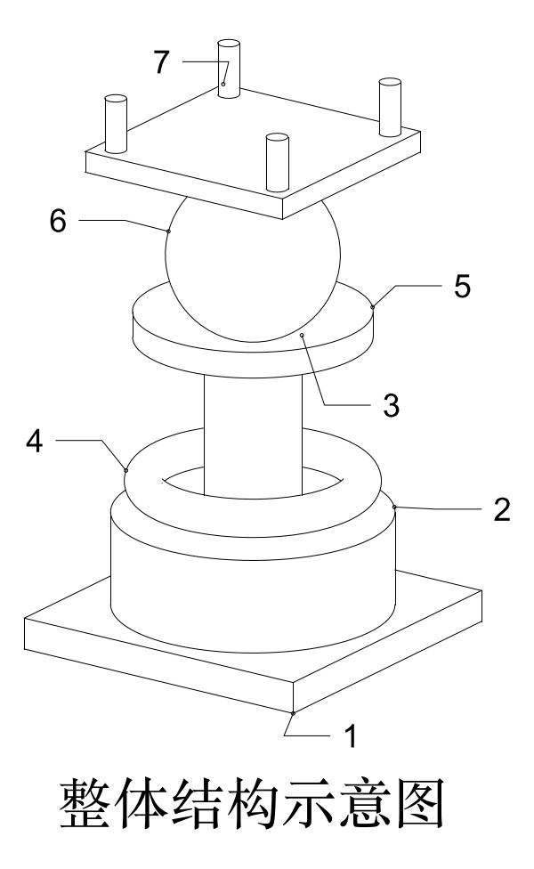
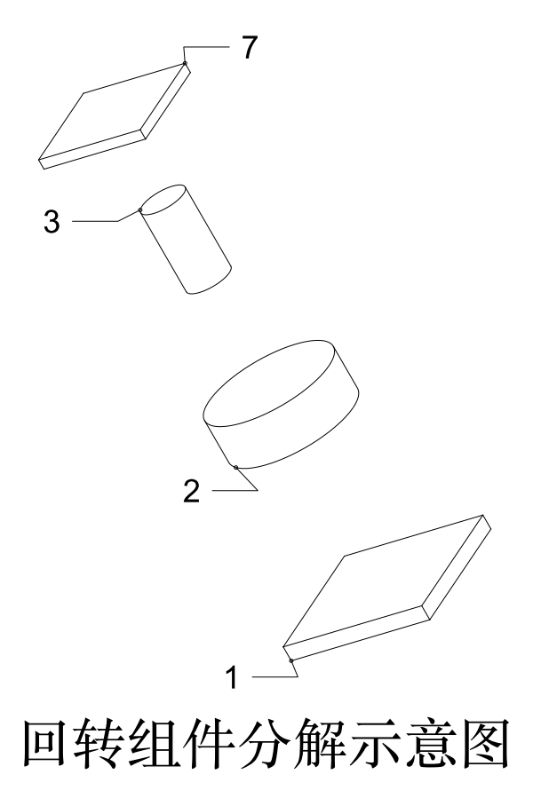

<div align="center">

# patent-figure-kit

**从 3D CAD 装配体（STEP）确定性地生成专利附图 —— 线条、引线、附图标记全部由脚本计算，模型只写一份 `figure-plan.json`**

[](LICENSE)
[](#安装)
[](SKILL.md)
[](AGENTS.md)

[中文](#这是什么) · [English](#english) · [快速开始](#快速开始) · [工作流](#工作流) · [文档](#文档)

</div>

<p align="center">
  
  
</p>
<p align="center"><sub>上图由仓库自带的合成装配体 <code>tests/fixtures/synthetic.stp</code> 渲染，不含任何真实产品数据。</sub></p>

---

## 这是什么

写专利说明书附图最耗时的不是画线，而是：**拆几张图、每个零件叫什么、标号怎么排不重叠、引线怎么走、标号表和说明书对不对得上。**

这个工具把「出图意图」压缩成一份 schema 严格的 JSON，其余全部交给脚本：

| 谁来做 | 做什么 |
| --- | --- |
| 你 / 大模型 / 人在浏览器里点 | 写 `figure-plan.json`：分几张图、零件的中文术语、哪些标准件不标号 |
| 脚本（确定性） | 解析 STEP、隐藏线消隐、爆炸方向、图面角度、引线与标号避让、连续发号、QA 闸门、DXF/DWG 输出 |

核心约束：**模型不得手写坐标、字高、标号或渲染脚本。** 同一份 plan 在任何机器上渲出逐位相同的 DXF，由验收套件里的金样哈希校验。

除此之外还有：

- **Plan Studio / Workbench**：本地浏览器界面，3D 点选与框选零件、分组成图、AI 起草零件名（可选）、渲染、导出；另提供 REST 与 MCP 接口
- **方法流程图**：写一份 `flowchart.json`，自动生成 S101 式步骤号与连线
- **既有图纸清理（Route B）**：对已有 DXF/DWG/矢量图去除附图标记、保留功能性文字、统一实线、转 DWG 并审计
- **质量闸门**：13 项检查（标号重叠、字高下限、页面占用、引线越界、图上不得有明细表和内部件号……），并自带「故意弄坏一张图、闸门必须判不通过」的自证用例

> **适用范围**：规则依据与默认版式面向**中国国家知识产权局（CNIPA）**的附图要求（见 [`references/patent-figure-spec.md`](references/patent-figure-spec.md)，附官方条款出处）。术语与图题默认中文；输出是 DXF，其他局的格式要求需自行核对。本工具不构成法律意见。

## 快速开始

### 安装

```bash
git clone https://github.com/janauto/patent-figure-kit.git
cd patent-figure-kit
python3 -m pip install -r requirements-pinned.txt     # 出图链路依赖（版本已锁定）
python3 scripts/doctor.py                              # 环境自检
```

只想用浏览器界面时再装：`python3 -m pip install fastapi uvicorn httpx openpyxl`。
DWG 转换需要本机装有 AutoCAD 或 LibreDWG 之一，没有也不影响 DXF 出图。

### 十行跑通示例

```bash
python3 scripts/analyze_assembly.py tests/fixtures/synthetic.stp -o assembly.json --include 'SYN-*'
python3 scripts/validate_figure_plan.py examples/synthetic/figure-plan.json --assembly assembly.json
python3 scripts/render_patent_figure.py examples/synthetic/figure-plan.json --assembly assembly.json \
        -o out/ --preview
```

得到 `out/fig1.dxf`、`out/fig2.dxf`、预览 PNG，以及 `out/reference-numerals.json`
（含可直接粘进说明书的「附图标记说明：1—底座；2—回转座；…」）。

### 换成你自己的模型

```bash
python3 scripts/analyze_assembly.py YOUR.stp -o assembly.json --include '*' --exclude '*SCREW*'
# 然后写 figure-plan.json（格式见 SKILL.md），或：
python3 scripts/plan_studio.py YOUR.stp        # 浏览器里点选生成 plan
```

## 工作流

```
doctor → analyze → 写 plan → validate → render（内置 QA 闸门）→ convert（DWG）→ annotate（图N + 件号表）
                      ↑                      │
                      └── 失败时只改 plan ───┘
```

每个 CLI 都支持 `--help` 与 `--json`，退出码 `0` 通过 / `1` 失败 / `2` 用法错误。
报错与未通过的检查项都附 `hint`，指明该怎么改 plan。

## 用作 Agent Skill

- **Claude Code**：把本仓库放进 `~/.claude/skills/patent-figure-kit/`（或任意 skills 目录），入口是 [`SKILL.md`](SKILL.md)
- **Codex / 其他 Agent 运行时**：入口是 [`AGENTS.md`](AGENTS.md)（只做路由，不含流程）
- 想验证某个模型「是否守规矩」：按 [`acceptance/行为验收.md`](acceptance/行为验收.md) 走一遍

> SKILL.md 中的 frontmatter 名称仍是 `patent-drawing-dwg-cleanup`（历史名称，保持不变以免破坏已有引用）。

## 验证安装

```bash
python3 acceptance/run_acceptance.py
```

14 个节点，约 2 分半（含 188 个单元测试），全部通过才退出 0。其中：

- **N8**：故意把合格图的引线锚点搬离 40 mm，闸门必须判 FAIL —— 证明闸门不是摆设
- **N10**：与仓库内金样哈希比对 —— 证明「同一 plan，处处同一张图」

细节见 [`acceptance/README.md`](acceptance/README.md)。

## 目录结构

```
SKILL.md                 Agent 工作流（Route A：STEP→附图；Route B：清理既有图）
AGENTS.md                非 Claude 运行时的入口路由
docs/impl-contract.md    模块边界、JSON 形状、确定性规则、版面算法（唯一权威）
references/              CNIPA 附图规范（含出处）、CAD 到图纸的背景资料
schemas/                 figure-plan / assembly 的 JSON Schema
scripts/                 全部 CLI 与 patent_figure/ 内核
webui/                   Plan Studio / Workbench 前端（内含 three.js，MIT）
acceptance/              验收套件
tests/                   单元测试与合成装配体夹具
examples/synthetic/      可直接运行的示例 plan 与产物
```

## 文档

| 想了解 | 看 |
| --- | --- |
| 工作流与全部命令 | [SKILL.md](SKILL.md) |
| 模块接口、确定性与版面算法 | [docs/impl-contract.md](docs/impl-contract.md) |
| 为什么这样设计 | [docs/iteration-plan-v2.md](docs/iteration-plan-v2.md) |
| 浏览器界面的设计 | [docs/plan-studio-proposal.md](docs/plan-studio-proposal.md) |
| 附图形式要求与法条出处 | [references/patent-figure-spec.md](references/patent-figure-spec.md)、[docs/patent-regulation-research.md](docs/patent-regulation-research.md) |

## 已知限制

- 输入仅支持 **STEP**（`.stp` / `.step`），不直接读 SolidWorks / CATIA 原生格式
- 隐藏线消隐基于 OpenCASCADE（`cadquery-ocp`），极复杂装配体（数千零件）会慢；建议用 `--include/--exclude` 先收窄
- DWG 输出依赖 AutoCAD 或 LibreDWG；LibreDWG 不适合超大合并图纸
- 「跨机器逐位一致」目前只在作者的 macOS / Python 3.9 环境验证过；欢迎在其他平台跑 `acceptance/run_acceptance.py` 并反馈 N10 结果
- 默认中文术语与 CNIPA 版式；英文术语/USPTO/EPO 版式尚未适配

## 数据与密钥

- Workbench 的项目数据在 `~/.patent-workbench`，设置与密钥在 `~/.config/patent-workbench/config.json`（0600），**都不在仓库里**，也请不要提交
- AI 起草零件名是可选功能（DeepSeek API，或本机 CodeBuddy CLI 兜底），只用来起草**语义**（零件名、流程图步骤文字），输出一样要过校验器。密钥只通过环境变量 `DEEPSEEK_API_KEY` 或本机配置文件提供
- 提交前请确认 STEP 文件和生成的附图不含未公开的产品信息 —— 专利公开前的图纸属于商业秘密

## 贡献

欢迎 Issue 与 PR。提交前请跑 `python3 acceptance/run_acceptance.py`。
修改 `docs/impl-contract.md` 中的依赖版本表时，需同步 `scripts/doctor.py` 的 `PINNED` 与 `requirements-pinned.txt`。

## 许可

[MIT](LICENSE)。`webui/vendor/` 内含 three.js r0.160.1（MIT，见 [`webui/vendor/LICENSE`](webui/vendor/LICENSE)）。

---

## English

**patent-figure-kit** turns a 3D CAD assembly (STEP) into patent figures — assembly and exploded views with leader lines and reference numerals — **deterministically**. The only artefact an LLM (or a human in the browser UI) authors is a schema-validated `figure-plan.json`; every coordinate, text height, layout angle and numeral is computed by scripts, gated by 13 QA checks, and written as DXF (optionally DWG). The same plan renders bit-identical output on any machine, checked against a golden digest in the acceptance suite.

It also ships a local web workbench (3D part picking, REST + MCP endpoints), a method-flowchart renderer, and a route for cleaning existing DXF/DWG patent drawings (strip reference numerals, keep functional labels, make lines continuous).

**Scope:** layout rules and default style follow **CNIPA** (China) drawing requirements; part terms and captions are Chinese by default. Other offices' formats (USPTO, EPO) are not yet adapted. Not legal advice.

```bash
git clone https://github.com/janauto/patent-figure-kit.git && cd patent-figure-kit
python3 -m pip install -r requirements-pinned.txt
python3 scripts/doctor.py
python3 scripts/analyze_assembly.py tests/fixtures/synthetic.stp -o assembly.json --include 'SYN-*'
python3 scripts/render_patent_figure.py examples/synthetic/figure-plan.json --assembly assembly.json -o out/ --preview
python3 acceptance/run_acceptance.py     # 14 checks, ~2.5 min
```

Use it as a Claude Code skill via [`SKILL.md`](SKILL.md), or from Codex / other agent runtimes via [`AGENTS.md`](AGENTS.md). The authoritative specification is [`docs/impl-contract.md`](docs/impl-contract.md). MIT licensed.
