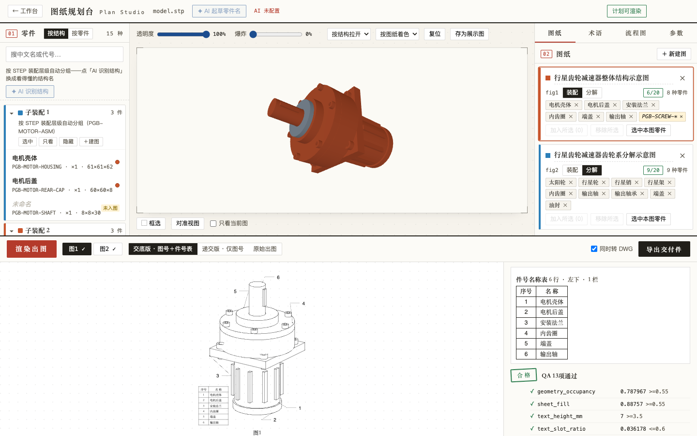
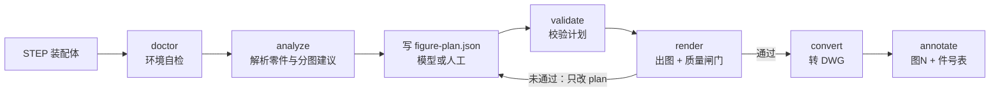
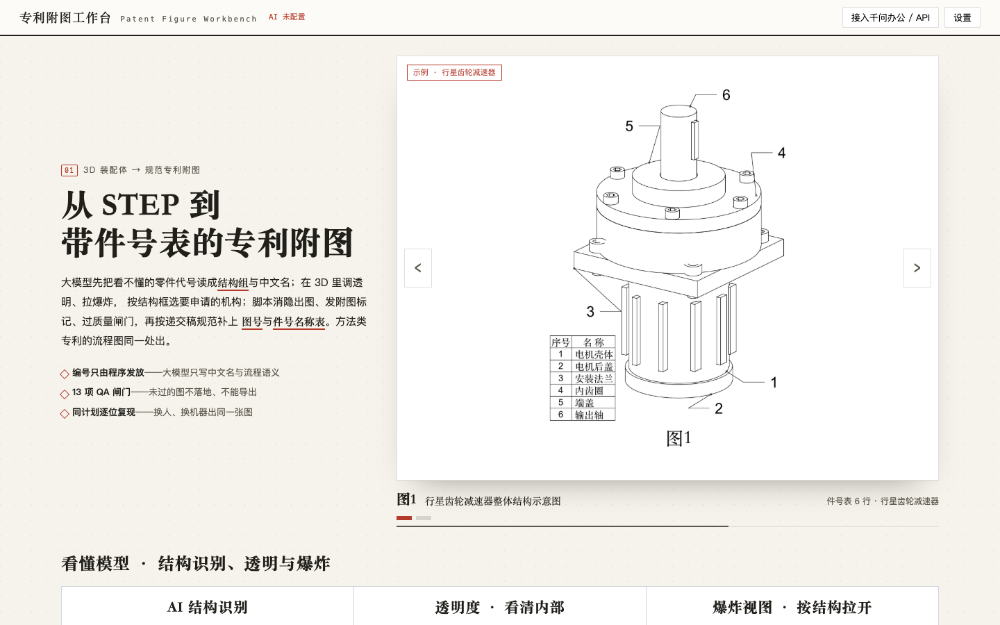

<div align="center">

# patent-figure-kit — 从 STEP 装配体一键生成规范专利附图，标号与引线全由脚本计算

[](LICENSE)
[](#1-环境要求)
[](SKILL.md)
[](AGENTS.md)

[中文](#这是什么) · [English](#english)

**[快速开始](#快速开始) · [工作流](#工作流) · [浏览器界面](#浏览器界面) · [作为-agent-技能使用](#作为-agent-技能使用) · [文档](#文档索引) · [Issues](../../issues)**



<sub>Plan Studio 界面，示例为行星齿轮减速器（27 个零件实例）。装配体由 <code>scripts/make_demo_assemblies.py</code> 生成，与任何真实产品无关。</sub>

</div>

---

## 这是什么

写专利附图最耗时的不是画线，而是这几件事：拆成几张图、每个零件叫什么、标号怎么排才不重叠、引线怎么走、标号表和说明书对不对得上。

本工具把「出图意图」压缩成一份结构严格的 `figure-plan.json`，其余工作交给脚本：

| 谁来做 | 做什么 |
| --- | --- |
| 你、大模型，或在浏览器里点选的人 | 写 `figure-plan.json`：分几张图、零件的中文术语、哪些标准件不标号 |
| 脚本（结果可复现） | 解析 STEP、隐藏线消隐、爆炸方向、图面角度、引线与标号避让、连续发号、质量闸门、输出 DXF / DWG |

**模型不得手写坐标、字高、标号或绘图脚本。** 同一份 plan 在任何机器上渲染出的 DXF 逐位相同，验收套件用仓库内的金样哈希来校验这一点。

### 你会得到什么

<table>
  <tr>
    <td align="center" width="50%">
      <br>
      <sub><b>图1 整体结构图</b> — 引线与标号自动避让，附图标记连续发放，件号表自动生成</sub>
    </td>
    <td align="center" width="50%">
      <br>
      <sub><b>图2 齿轮系分解图</b> — 沿主轴自动拉开，图面角度按长宽比自动求解</sub>
    </td>
  </tr>
</table>

上图由 [`examples/planetary-gearbox`](examples/planetary-gearbox/README.md) 生成，该示例还演示了如何按质量闸门的提示拆图。另外还会输出 `reference-numerals.json`，其中有可直接粘进说明书的句子：「附图标记说明：1—底座；2—回转座；……」。

### 主要能力

- **确定性出图** — 解析 STEP，做隐藏线消隐，输出连续实线的 DXF，可再转 DWG
- **质量闸门** — 每张图过 13 项检查：标号重叠、字高下限、页面占用、引线越界、图上不得出现明细表与内部件号等。未通过的图不会落盘
- **闸门自证** — 验收套件会故意弄坏一张图，闸门必须判不通过，以证明它不是摆设
- **浏览器界面** — 3D 点选与框选零件、分组成图、可选的 AI 起草零件名、渲染、导出；另提供 REST 与 MCP 接口
- **规范标注** — 把描述性图题换成「图N」，并在图面空白处放「序号｜名称」件号表，分交底版与递交版
- **方法流程图** — 写一份 `flowchart.json`，自动生成 S101 式步骤号与连线
- **既有图纸清理（Route B）** — 对已有 DXF / DWG / 矢量图去除附图标记、保留功能性文字、统一实线，并转成经审计的 DWG

### 与常见做法的对比

| 做法 | 标号与版面从哪来 | 结果可复现 | 有质量闸门 |
| --- | --- | :---: | :---: |
| 在 CAD 里手工画图、手工标号 | 人工逐个摆放 | ❌ | ❌ |
| 让大模型直接写绘图脚本 | 模型凭空编造版面常数 | ❌ | ❌ |
| **本工具** | 脚本按几何计算，模型只提供中文术语与分图意图 | ✅ | ✅ |

> **适用范围**：规则依据与默认版式面向中国国家知识产权局（CNIPA）的附图要求，条款出处见 [`references/patent-figure-spec.md`](references/patent-figure-spec.md)。术语与图题默认为中文，输出格式为 DXF。其他专利局的要求请自行核对。本工具不构成法律意见。

## 快速开始

### 1. 环境要求

| 依赖 | 是否必需 | 用途 | 检查命令 |
| --- | :---: | --- | --- |
| Python 3.9+ | ✅ | 运行环境 | `python3 --version` |
| `requirements-pinned.txt` 中的包 | ✅ | STEP 解析、DXF 读写等，版本已锁定 | `python3 scripts/doctor.py` |
| `fastapi` `uvicorn` `httpx` `openpyxl` `python-docx` | 可选 | 浏览器界面与 Word 导出需要，出图链路不依赖。**跑验收前请先装** | `python3 scripts/doctor.py` |
| AutoCAD 或 LibreDWG | 可选 | 转 DWG；都没有时仍可输出 DXF | `python3 scripts/doctor.py` |

已在 macOS（Python 3.9.6）上验证。Linux 与 Windows 尚未验证，欢迎反馈。

### 2. 安装

```bash
git clone https://github.com/janauto/patent-figure-kit.git
cd patent-figure-kit
python3 -m venv .venv
source .venv/bin/activate        # Windows 下用 .venv\Scripts\activate
python3 -m pip install -r requirements-pinned.txt
```

首次安装需要下载 `cadquery-ocp`，体积较大，请耐心等待。

如果要使用浏览器界面，或要运行第 6 步的验收，再装可选依赖：

```bash
python3 -m pip install fastapi uvicorn httpx openpyxl python-docx
```

### 3. 验证安装

```bash
python3 scripts/doctor.py
```

预期输出末尾是 `必需项 8/8 通过`（可选项的数量因机器而异）与 `结论：环境可用`，退出码为 `0`。输出中若有标注「可选」的缺失项，例如缺少字体或 AutoCAD，不影响出图，可以忽略。若必需项缺包，按提示执行 `python3 -m pip install -r requirements-pinned.txt`。

### 4. 跑通示例

```bash
python3 scripts/analyze_assembly.py tests/fixtures/synthetic.stp -o assembly.json --include 'SYN-*'
python3 scripts/validate_figure_plan.py examples/synthetic/figure-plan.json --assembly assembly.json
python3 scripts/render_patent_figure.py examples/synthetic/figure-plan.json --assembly assembly.json -o out/ --preview
```

预期结果：终端显示 `共 2 张图，全部通过`，`out/` 下出现 `fig1.dxf`、`fig2.dxf`、对应的预览 PNG 与 `reference-numerals.json`。

### 5. 试试更复杂的示例

行星齿轮减速器：27 个零件实例，含齿轮、轴承和螺钉，本机实测约 10 秒内出图。

```bash
python3 scripts/make_demo_assemblies.py -o examples/planetary-gearbox
python3 scripts/analyze_assembly.py examples/planetary-gearbox/demo-planetary-gearbox.stp -o assembly.json --include 'PGB-*'
python3 scripts/render_patent_figure.py examples/planetary-gearbox/figure-plan.json --assembly assembly.json -o out/ --preview
```

预期结果：终端显示 `共 2 张图，全部通过`，即上方展示的图1与图2。

### 6. 换成你自己的模型

```bash
python3 scripts/analyze_assembly.py YOUR.stp -o assembly.json --include '*' --exclude '*SCREW*'
```

然后写自己的 `figure-plan.json`，格式见 [SKILL.md](SKILL.md)。也可以用浏览器界面点选生成，见[浏览器界面](#浏览器界面)一节。

### 7. 运行验收（可选）

先装好第 2 步末尾的可选依赖，再运行：

```bash
python3 acceptance/run_acceptance.py
```

预期结果：14 个节点全部通过，退出码为 `0`（约 2 到 3 分钟）。注意不要用管道接输出，否则会吞掉退出码。详见[验收](#验收)一节。

<!-- For AI agents: full non-interactive install and smoke test, no credentials required:
git clone https://github.com/janauto/patent-figure-kit.git && cd patent-figure-kit && python3 -m venv .venv && . .venv/bin/activate && python3 -m pip install -r requirements-pinned.txt fastapi uvicorn httpx openpyxl python-docx && python3 scripts/doctor.py && python3 scripts/analyze_assembly.py tests/fixtures/synthetic.stp -o /tmp/assembly.json --include 'SYN-*' && python3 scripts/render_patent_figure.py examples/synthetic/figure-plan.json --assembly /tmp/assembly.json -o /tmp/out --preview
Expected: "共 2 张图，全部通过". Run acceptance (2-3 minutes; needs the optional UI packages above) with: python3 acceptance/run_acceptance.py -->

## 工作流



每个命令行工具都支持 `--help` 与 `--json`。退出码 `0` 表示通过，`1` 表示失败，`2` 表示用法错误。报错和未通过的检查项都附带 `hint`，指明该如何修改 plan。

## 浏览器界面

```bash
python3 -m pip install fastapi uvicorn httpx openpyxl python-docx   # 已在安装步骤装过则跳过
python3 scripts/workbench.py          # 打开 http://127.0.0.1:8790/?token=…
```



- **多工程工作台**：首页是示例轮播与工程列表，每个工程对应一个 Plan Studio
- **点选与框选**：左到右为窗选，右到左为交叉选；`Shift` 追加，`Alt` 减选
- **对外接口**：REST（`/v1/*`，文档在 `/docs`）与 MCP（`POST /mcp`，Bearer token）
- **只做语义草稿**：大模型（DeepSeek API，或本机 CodeBuddy CLI 兜底）只起草零件名与流程图文字，输出同样要过校验器，人工填写的名称不会被覆盖
- 只想单独使用点选界面时，可运行 `python3 scripts/plan_studio.py ASM.stp`

界面只监听 `127.0.0.1`，并校验 Host 头。**模型不得驱动浏览器界面**，应当通过 REST 或 MCP 调用。

## 作为 Agent 技能使用

- **Claude Code**：把本仓库放进 `~/.claude/skills/patent-figure-kit/`，入口是 [`SKILL.md`](SKILL.md)
- **Codex 及其他 Agent 运行时**：入口是 [`AGENTS.md`](AGENTS.md)，它只做路由，不含流程
- **检验模型是否守规矩**：按 [`acceptance/行为验收.md`](acceptance/行为验收.md) 走一遍，需要人看对话记录

`SKILL.md` 中 frontmatter 的技能名仍是 `patent-drawing-dwg-cleanup`。这是历史名称，为避免破坏已有引用而保留。

## 验收

```bash
python3 acceptance/run_acceptance.py
```

运行前需要先装可选依赖（`fastapi uvicorn httpx openpyxl python-docx`），N12 与 N14 会用到它们；缺包时 N12 会中断并给出安装提示。共 14 个节点，约 2 到 3 分钟（含 188 个单元测试），全部通过才返回 `0`。其中有两个节点值得单独说：

- **N8**：把合格图的引线锚点故意搬离 40 mm，闸门必须判为不通过，借此证明闸门有效
- **N10**：与仓库内金样哈希比对，证明同一份 plan 处处渲染出同一张图

详见 [`acceptance/README.md`](acceptance/README.md)。

## 目录结构

```
SKILL.md                 Agent 工作流（Route A：STEP 出图；Route B：清理既有图）
AGENTS.md                非 Claude 运行时的入口路由
docs/impl-contract.md    模块边界、JSON 形状、确定性规则、版面算法（唯一权威）
references/              CNIPA 附图规范（含出处）、CAD 到图纸的背景资料
schemas/                 figure-plan 与 assembly 的 JSON Schema
scripts/                 全部命令行工具，内核在 patent_figure/
webui/                   Workbench / Plan Studio 前端（内含 three.js）
acceptance/              验收套件
tests/                   单元测试与合成装配体
examples/synthetic/      最小示例（几秒跑完）
examples/planetary-gearbox/  进阶示例：27 个零件实例的行星齿轮减速器
docs/assets/             README 用图及其生成脚本
```

## 文档索引

| | 文档 | 内容 |
| --- | --- | --- |
| 📖 | [SKILL.md](SKILL.md) | 工作流与全部命令 |
| 📐 | [docs/impl-contract.md](docs/impl-contract.md) | 模块接口、确定性与版面算法 |
| 🧭 | [docs/iteration-plan-v2.md](docs/iteration-plan-v2.md) | 为什么这样设计 |
| 🖱️ | [docs/plan-studio-proposal.md](docs/plan-studio-proposal.md) | 浏览器界面的设计 |
| ⚖️ | [references/patent-figure-spec.md](references/patent-figure-spec.md) | 附图形式要求与条款出处 |
| 🔎 | [docs/patent-regulation-research.md](docs/patent-regulation-research.md) | 法规查证记录 |
| ✅ | [acceptance/README.md](acceptance/README.md) | 验收套件说明 |

## 已知限制

- 输入仅支持 **STEP**（`.stp` / `.step`），不直接读取 SolidWorks、CATIA 等原生格式
- 隐藏线消隐基于 OpenCASCADE（`cadquery-ocp`），数千个零件的超大装配体会很慢，建议先用 `--include` / `--exclude` 收窄范围
- DWG 输出依赖 AutoCAD 或 LibreDWG；LibreDWG 不适合超大的合并图纸
- 跨机器逐位一致目前只在作者的 macOS 与 Python 3.9 环境验证过。欢迎在其他平台运行 `acceptance/run_acceptance.py` 并反馈 N10 的结果
- 默认使用中文术语与 CNIPA 版式，英文术语以及 USPTO、EPO 版式尚未适配
- 目前不生成剖视图，需要时请另行绘制

## 数据与密钥

- Workbench 的项目数据在 `~/.patent-workbench`，设置与密钥在 `~/.config/patent-workbench/config.json`（权限 0600）。两者都不在仓库里，请不要提交
- AI 起草零件名是可选功能。密钥只通过环境变量 `DEEPSEEK_API_KEY` 或本机配置文件提供，不会写入仓库
- 公开前的专利附图属于商业秘密。提交 STEP 文件或生成的附图之前，请确认其中不含未公开的产品信息

## 贡献与许可证

欢迎提 Issue 和 PR。提交前请运行 `python3 acceptance/run_acceptance.py`。修改 `docs/impl-contract.md` 中的依赖版本表时，需要同步 `scripts/doctor.py` 的 `PINNED` 与 `requirements-pinned.txt`。

本项目采用 [MIT 许可证](LICENSE)。`webui/vendor/` 内含 three.js r0.160.1（MIT，见 [`webui/vendor/LICENSE`](webui/vendor/LICENSE)）。

[⬆ 回到顶部](#patent-figure-kit--从-step-装配体一键生成规范专利附图标号与引线全由脚本计算)

---

## English

**patent-figure-kit** turns a 3D CAD assembly (STEP) into patent figures — assembly and exploded views with leader lines and reference numerals — in a **deterministic** way. The only artefact an LLM (or a human in the browser UI) authors is a schema-validated `figure-plan.json`. Every coordinate, text height, layout angle and numeral is computed by scripts, checked by 13 QA gates, and written as DXF (optionally DWG). The same plan renders bit-identical output on any machine, verified against a golden digest in the acceptance suite.

It also ships a local web workbench (3D part picking, REST and MCP endpoints), a method-flowchart renderer, and a route for cleaning existing DXF/DWG patent drawings (strip reference numerals, keep functional labels, make lines continuous).

**Scope:** layout rules and default style follow **CNIPA** (China) drawing requirements, and part terms and captions are Chinese by default. Other offices' formats (USPTO, EPO) are not yet adapted. Not legal advice.

```bash
git clone https://github.com/janauto/patent-figure-kit.git && cd patent-figure-kit
python3 -m venv .venv && source .venv/bin/activate
python3 -m pip install -r requirements-pinned.txt
python3 scripts/doctor.py
python3 scripts/analyze_assembly.py tests/fixtures/synthetic.stp -o assembly.json --include 'SYN-*'
python3 scripts/render_patent_figure.py examples/synthetic/figure-plan.json --assembly assembly.json -o out/ --preview
python3 -m pip install fastapi uvicorn httpx openpyxl python-docx   # optional UI packages, needed by the acceptance run
python3 acceptance/run_acceptance.py     # 14 checks, 2-3 minutes
```

Use it as a Claude Code skill via [`SKILL.md`](SKILL.md), or from Codex and other agent runtimes via [`AGENTS.md`](AGENTS.md). The authoritative specification is [`docs/impl-contract.md`](docs/impl-contract.md). MIT licensed.
